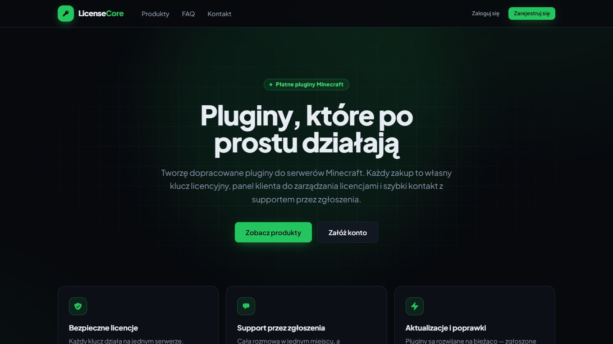
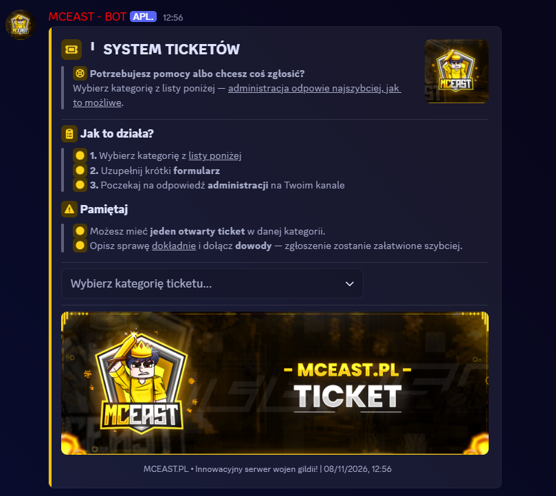
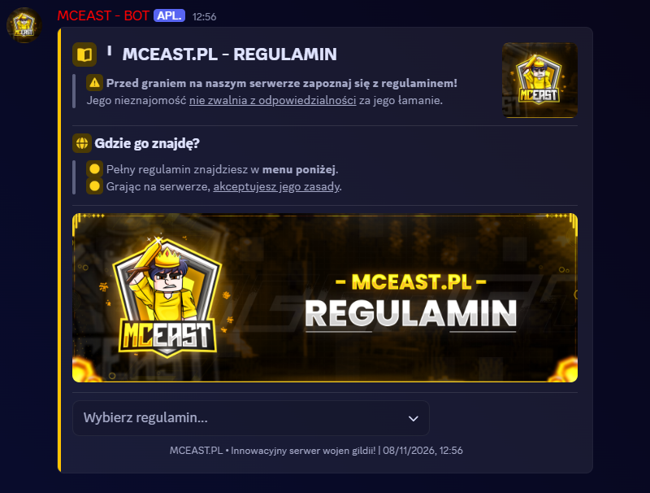
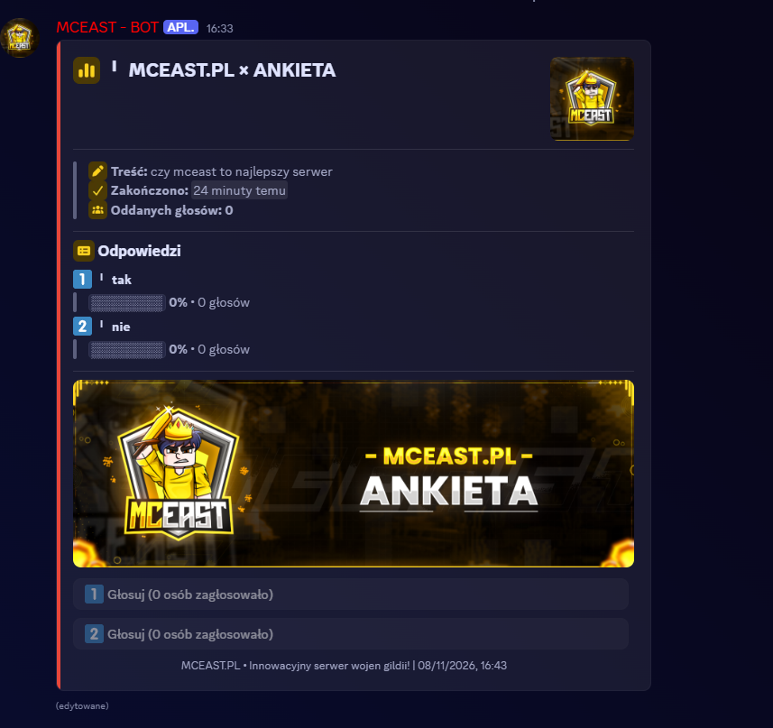
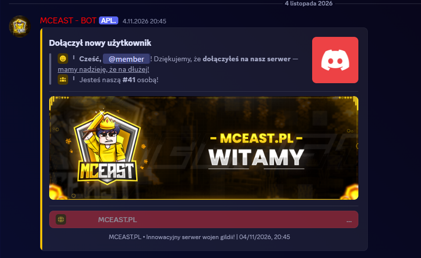

  

  
<b>Hi, I'm MrPikchu</b> 

  
    
  
  
  

 

I'm a developer from Poland building the software behind Minecraft networks and the tools around it.

 **40+ plugins and server cores** for Paper and Spigot 
 **7 Discord bots** for communities and teams 
 **LicenseCore**, a platform for selling and verifying paid plugins 
 Commissions open, in Polish or English

 

  <picture>
    <source media="(prefers-color-scheme: light)" srcset="https://skillicons.dev/icons?i=java,python,ts,js,php,go,gradle,maven,nodejs,express,fastapi,postgres,sqlite,react,vite,tailwind,threejs,docker,githubactions,git&theme=light&perline=10">
    
  </picture>

  <code>Paper</code> <code>Spigot</code> <code>Velocity</code> <code>NMS</code> <code>PacketEvents</code> <code>LiteCommands</code> <code>Triumph GUI</code> <code>Okaeri</code> <code>dream-platform</code> <code>PlaceholderAPI</code> <code>LuckPerms</code> <code>Vault</code> <code>WorldGuard</code> <code>H2</code> <code>ASM</code> <code>discord.py</code>

 **Java projects in action**

<table>
  <tr>
    <td width="44%"></td>
    <td>
       <b>Dream-MineStarPatrons</b> 
      Spigot 1.20+ · dream-platform · PlaceholderAPI
      <ul>
        <li>Patron draw with an animated title roll and sounds</li>
        <li>Free draw on a cooldown, faster draws paid in Dragon Shards</li>
        <li>Timed patrons with their own combat abilities</li>
        <li>Hero Hour server event with separate weekend hours and a boss bar</li>
        <li>In-game editor and admin commands</li>
      </ul>
      <a href="https://www.youtube.com/watch?v=U0MsnM70KTI&t=38s">Watch the showcase</a>
    </td>
  </tr>
  <tr>
    <td width="44%"></td>
    <td>
       <b>Dream-AnarchiaRaids</b> 
      Daily server raids · PacketEvents · Vault · WorldEdit
      <ul>
        <li>Raids start at a random time inside a configured window</li>
        <li>Players pay for a drop into the raid area</li>
        <li>Timed mob waves with breaks and a treasury that drops loot</li>
        <li>Schematic maps fit the terrain, and the original land is restored afterwards</li>
        <li>In-world waypoint, boss bar and a full GUI creator</li>
      </ul>
      <a href="https://www.youtube.com/watch?v=aLyEF7Kf1Tw&t=37s">Watch the showcase</a>
    </td>
  </tr>
  <tr>
    <td width="44%"></td>
    <td>
       <b>Dream-CustomMinestarItems</b> 
      Paper 1.20.4+ · Java 21 · co-developed with K3ymilo
      <ul>
        <li>Event items with custom abilities: Elemental Cage, Ice Staff, Sand Castle, Death Field, Excalibur</li>
        <li>Each item's look and behaviour is configurable</li>
        <li>GUI panel for editing lore, materials, settings and regions</li>
        <li>Items can be blocked in selected WorldGuard regions</li>
      </ul>
      <a href="https://www.youtube.com/watch?v=md6QjP3cN-A&t=97s">Watch the showcase</a>
    </td>
  </tr>
</table>

Videos published by my collaborator <a href="https://www.youtube.com/@Keymilo">Keymilo</a>.

 **Web Pages in action**

<table>
  <tr>
    <td width="44%"></td>
    <td>
       <b>LicenseCore</b> 
      TypeScript · Express · SQLite · Vite · Tailwind
      <ul>
        <li>Public store with product pages and galleries</li>
        <li>A personal licence key with every purchase</li>
        <li>Customer panel for managing licences and requesting a server move</li>
        <li>Support tickets with live replies</li>
        <li>Separate admin panel for products, licences and customers</li>
      </ul>
      <a href="https://license-core.pro3w.pl">Visit license-core.pro3w.pl</a>
    </td>
  </tr>
</table>

 More websites coming soon.

 **Discord Bots in action**

<table>
  <tr>
    <td width="50%" valign="top"> <b>Tickets</b> panel with a category menu and a short form</td>
    <td width="50%" valign="top"> <b>Rules</b> panel with a select menu</td>
  </tr>
  <tr>
    <td width="50%" valign="top"> <b>Polls</b> vote buttons and result bars</td>
    <td width="50%" valign="top"> <b>Welcome</b> greeting with a member count and banner</td>
  </tr>
</table>

 More bots coming soon.

 **More Minecraft plugins**

| Project | What it does |
|---|---|
|  **Anarchia-Drop** | Stone drop system with per-resource chances, mining levels that raise drop chance, player toggles, a mining leaderboard and a GUI editor |
|  **Anarchia-Items** | Custom items with cooldowns: CobbleX, grenades, throwable TNT, farmers, turbo drops and enchantments, plus a GUI panel for editing them |
|  **Anarchia-Kits** | Kit system with a claim menu, item previews, permissions, cooldowns and an in-game creator |
|  **Lobby-Core** | Lobby for Velocity networks with double jump, a live server selector, queues and a PvP mode |
|  **QueueProxy** | Join queue running at the Velocity proxy level |
|  **Bans** | Punishment system: ban, tempban, mute, kick, warn and IP ban, with a player lookup GUI |
|  **Portfel** | Custom currency independent of Vault, with a shop GUI, transaction history and receipts |
|  **Kowal** | Blacksmith system with netherite upgrades, repairs, a virtual anvil and custom enchanted books |
|  **BossBar** | Custom boss bars with hex colours, gradients, animated text and an in-game editor |

 **Platforms and tools**

 **LicenseCore** · `TypeScript` `Express` `SQLite` `Tailwind` `Java` 
Licensing system for paid Minecraft plugins. Plugins verify their keys against an API, and the site covers the public storefront, a customer panel with licences, reset requests and support tickets, and a separate admin panel.

 **LicenseCore Generators** · `React` `three.js` `TypeScript` `PHP` 
Toolkit for Minecraft servers and Discord communities that runs almost entirely in the browser. It generates chest GUI textures with DeluxeMenus configs and 3D item models with ready resource packs, and includes an AI assistant.

 **Obfuscator 2.0** · `Java` `ASM` `Maven` 
Bytecode obfuscator for Paper plugins with a GUI and CLI. It covers safe class and member mapping, string encryption, number and control flow obfuscation, keep patterns, deterministic builds and bytecode verification of the output.

 **Trading-Bot** · `FastAPI` `React` `PostgreSQL` `Docker` 
Automated CFD index trading app with a TradingView-style PWA dashboard. It has 3 strategies, a risk manager with mandatory stop-loss and drawdown limits, walk-forward backtests, RSS news and push notifications. It runs on a simulator with real market prices, not real money.

 **Discord bots**

| Bot | What it does |
|---|---|
|  [**Verification Bot**](https://github.com/MrPikchu/MrPikchu-Verification-Bot) | Auto join role and a math challenge button that grants a verification role |
|  [**Welcome Bot**](https://github.com/MrPikchu/MrPikchu-Welcome-Bot) | Welcome and goodbye embeds, configured entirely through `config.json` |
|  **Community server bots** | Verification, moderation, anti-raid and anti-nuke, logs, tickets, recruitment, suggestions and giveaways, built with Components V2 |
|  **Team management bot** | Activity stats, working hours, orders and an admin panel |
|  **Studio bot** | Bilingual tickets, saved transcripts and a purchase webhook from Roblox |

 **Work with me**

Commissions are open for Minecraft plugins, Velocity networks and Discord bots, in Polish or English. Most of my code is private or built for clients, so ask if you'd like to see more.

[mrpikchubiz@gmail.com](mailto:mrpikchubiz@gmail.com) · Discord: `mrpikchu`

  

